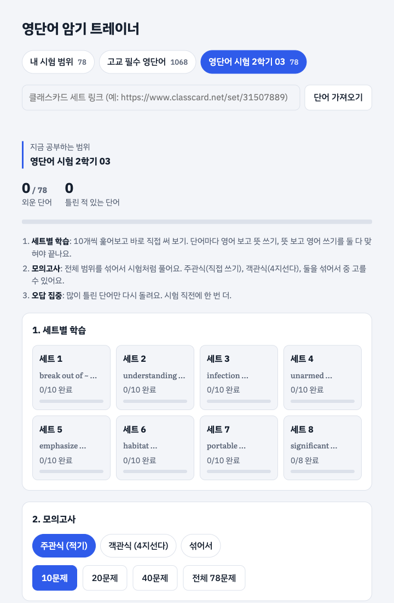
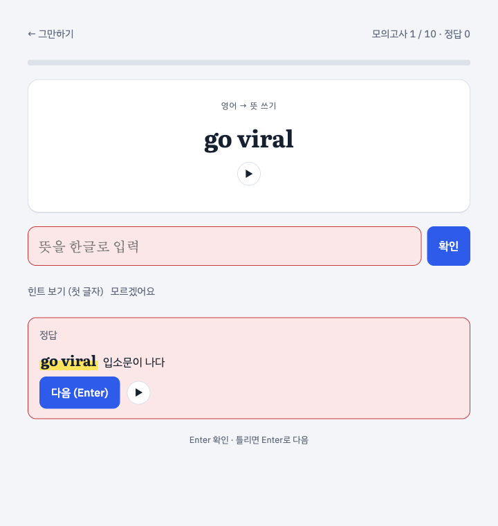
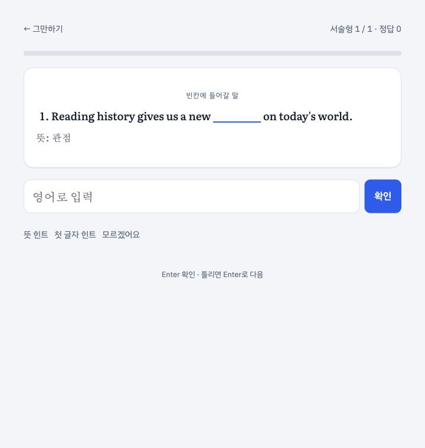
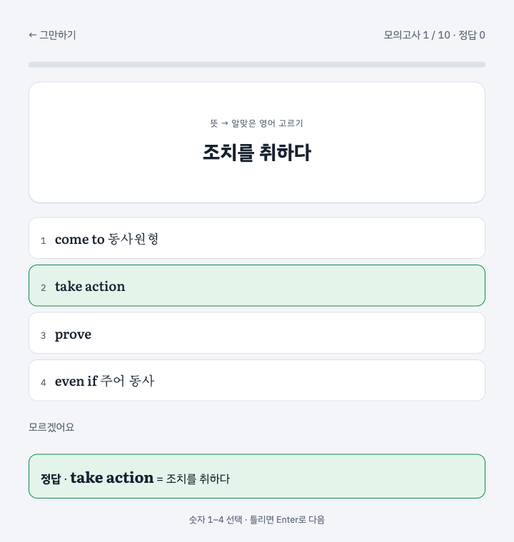
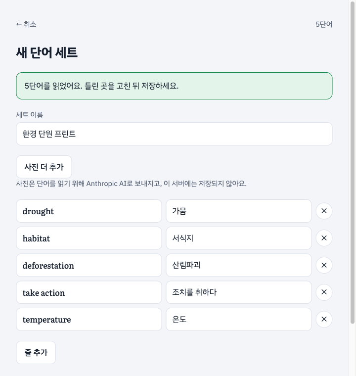
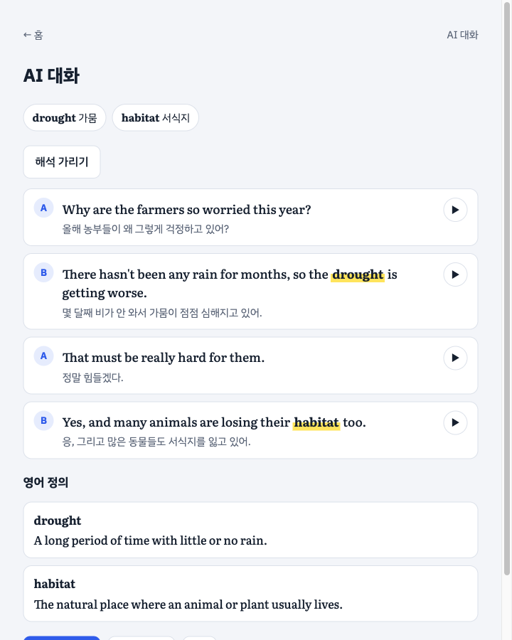

<div align="center">

# 📚 영단어 암기 트레이너

**직접 써 보면서 외우는 영어 단어 암기 앱**

세트별 학습 · 모의고사 · 빈칸 주관식 · 서술형 · 오답 집중까지, 시험 공부에 필요한 흐름을 한 화면에 담았습니다.<br>
클래스카드 링크나 **단어장 사진**으로 세트를 만들고, **AI가 단어 2개로 대화 예문과 영어 정의**를 써 줍니다.

<a href="https://eng-word-y.vercel.app"></a>


</div>

---

## 🖼️ 화면

| 홈 | 적기 | 서술형 | 객관식 (4지선다) |
|:---:|:---:|:---:|:---:|
|  |  |  |  |

| 사진으로 세트 만들기 | AI 대화 만들기 |
|:---:|:---:|
|  |  |

## ✨ 주요 기능

| | 기능 | 설명 |
|:---:|---|---|
| 1️⃣ | **세트별 학습** | 10개씩 훑어보고 바로 써 보기. 틀린 단어는 곧 다시 나오는 간격 반복 방식 |
| 2️⃣ | **모의고사** | 10 / 20 / 40문제 또는 전체. 적기 · 객관식 · 섞어서 중 선택 |
| 3️⃣ | **빈칸 주관식** | 세 문장에 공통으로 들어갈 단어 쓰기 (내 시험 범위) |
| 4️⃣ | **서술형** | 영어 문장 하나에서 빠진 단어 쓰기. 156문항을 직접 만들어 둠 |
| 5️⃣ | **오답 집중** | 많이 틀린 단어부터 최대 15개 다시 학습 |
| 6️⃣ | **AI 대화 만들기** | 단어 2개가 한 줄씩 들어간 A·B 4줄 대화 + 한글 해석 + 각 단어의 영어 정의 |
| 📷 | **사진으로 세트 만들기** | 단어장 사진을 찍으면 AI가 단어와 뜻을 읽어 세트로 만듦 |
| ✏️ | **내 세트** | 직접 만들기, 단어 편집, 이름 변경, 삭제 (이 브라우저에 저장) |
| 🔗 | **클래스카드 가져오기** | 세트 링크만 넣으면 새 단어책으로 추가 |
| 🔊 | **발음 듣기** | 기기에 있는 고품질 영어 음성을 골라 읽어 줌 |
| 🌙 | **다크 모드** | 기기 설정에 맞춰 자동 전환 |

## 🤖 만든 방식

[Claude Code](https://claude.com/claude-code)와 대화하며 만든 **바이브 코딩** 프로젝트입니다.
기능 아이디어와 방향은 직접 정하고, 코드 작성·테스트·배포 설정은 AI와 함께 진행했습니다.

- 시험 공부에 필요한 기능(세트별 학습, 모의고사, 빈칸 문제, 서술형, 오답 집중)을 하나씩 요청하며 확장
- 클래스카드 세트 페이지 구조를 분석해 링크 하나로 단어를 가져오는 기능 추가
- 실제 브라우저(Playwright)로 화면을 눌러 보며 동작 확인

## 🛠️ 기술 스택

| 영역 | 사용 기술 |
|---|---|
| 프론트엔드 | HTML, CSS, JavaScript (프레임워크 없이 파일 하나), Web Speech API (발음) |
| 백엔드 | Python 3.12, FastAPI, Uvicorn |
| 저장 | SQLite (학습 기록), 텍스트 파일 (단어책), localStorage |
| AI | Claude API (`claude-opus-5-5`, 구조화 출력) — 사진 읽기, 대화·정의 만들기 |
| 테스트 | pytest (AI 호출은 가짜로 바꿔서 검사) |
| 배포 | Vercel 무료 플랜 (서버리스 Python), GitHub push 시 자동 배포 |

## 📖 단어책

| 단어책 | 단어 수 | 구성 |
|---|---:|---|
| 내 시험 범위 | 78개 | 시험 범위 단어. 빈칸 주관식(예문 3개)과 서술형 문항 포함 |
| 영단어 시험 2학기 03 | 78개 | 클래스카드에서 가져온 세트. 서술형 문항 포함 |
| 고교 필수 영단어 | 1,068개 | Day 01 ~ Day 43 (하루 25개). 단어마다 품사, 뜻, 예문 |
| 클래스카드에서 가져온 세트 | 세트마다 다름 | 세트 전체가 한 범위. 단어와 뜻만 있음 |
| 내 세트 (직접·사진) | 최대 500개 | 이 브라우저에만 저장. 다른 기기에서는 보이지 않음 |

고교 필수 영단어는 수능·내신에 자주 나오는 단어와 숙어(`carry out`, `be aware of` 등)로 구성했고, 뒤쪽 Day는 수능 심화 단어입니다.
처음 열면 아직 다 외우지 못한 첫 Day부터 보여 주고, 다음부터는 마지막으로 보던 Day를 엽니다.

## 🚀 실행 방법

### 서버와 함께 실행 (모든 단어책)

[uv](https://docs.astral.sh/uv/)가 설치돼 있어야 합니다.

```bash
./run.sh
```

처음 실행하면 `.venv`를 만들고 패키지를 설치한 뒤 http://localhost:8001 을 엽니다.
AI 기능까지 쓰려면 `.env.example`을 `.env`로 복사하고 값을 채운 뒤 다시 실행합니다(아래 **AI 설정과 보안**).

테스트:

```bash
uv pip install --python .venv/bin/python -r requirements-dev.txt
.venv/bin/python -m pytest tests -q
```

### 파일만 열기 (내 시험 범위만)

`index.html`을 브라우저로 바로 열어도 됩니다. 서버가 없으면 단어책 선택이 숨겨지고 **내 시험 범위 78개**만 쓸 수 있습니다. 학습 기록은 브라우저에만 저장됩니다.

<details>
<summary><b>Vercel에 배포하기</b></summary>

1. [Vercel](https://vercel.com)에 GitHub 계정으로 가입합니다. Hobby(무료) 플랜은 카드 등록이 필요 없습니다.
2. **Add New → Project**에서 이 저장소를 **Import**하고 설정은 그대로 둔 채 **Deploy**를 누릅니다. FastAPI 앱(`server.py`의 `app`)을 자동으로 찾아 배포합니다.
3. 배포가 끝나면 `https://<프로젝트 이름>.vercel.app` 주소가 생깁니다. 이후로는 `main`에 push할 때마다 자동으로 다시 배포됩니다.

> [!NOTE]
> Vercel에서는 코드 폴더가 읽기 전용이라, 화면에서 가져온 세트와 학습 기록은 서버의 임시 폴더(`/tmp`)에 저장됩니다. 임시 폴더는 서버가 바뀌면 비워지므로 언제든 사라질 수 있습니다. 학습 기록은 브라우저에도 함께 저장되고, 저장소에 커밋된 단어책은 항상 남습니다.

</details>

## 🔐 AI 설정과 보안

사진 읽기와 AI 대화는 서버에 **API 키와 접근 코드가 둘 다** 있을 때만 켜집니다. 키만 넣으면 잠긴 상태로 남습니다.

**키 넣는 곳 (Vercel)**

1. https://console.anthropic.com → **API Keys → Create Key**로 키를 만듭니다. 같은 곳 **Limits**에서 **월 사용 한도를 낮게** 설정합니다. 요금이 새는 것을 막는 마지막 안전장치입니다.
2. Vercel → 프로젝트 → **Settings → Environment Variables**에 두 값을 추가합니다.

   | 이름 | 값 |
   |---|---|
   | `ANTHROPIC_API_KEY` | 발급받은 키 |
   | `AI_PASSCODE` | 직접 정한 긴 코드. 예: `openssl rand -base64 18` |
   | `AI_MODEL` (선택) | 다른 모델. 비용을 줄이려면 `claude-sonnet-5-5` |

3. **Deployments → 최신 배포 → Redeploy**. 환경 변수는 다시 배포해야 적용됩니다.
4. 사이트에서 AI 기능을 처음 쓸 때 접근 코드를 한 번 입력하면 그 브라우저에 기억됩니다. 홈 아래 **AI 코드 지우기**로 지울 수 있습니다.

> [!WARNING]
> API 키는 채팅, 코드, GitHub 어디에도 붙여 넣지 말고 Vercel 환경 변수(로컬은 `.env`)에만 넣으세요. `.env`는 git에 올라가지 않습니다.

**보안 장치**

| 위험 | 막는 방법 |
|---|---|
| 키 유출 | 키는 서버 환경 변수에만 있고 브라우저·응답·로그로 나가지 않음 |
| 남이 AI를 써서 요금 발생 | 접근 코드가 없으면 AI 기능이 꺼짐. 코드는 `hmac.compare_digest`로 비교 |
| 코드 맞히기 / 과다 호출 | IP마다 10분에 코드 실패 10번, AI 호출 30번까지만 (넘으면 429) |
| 요금 폭주 | Anthropic Console 월 한도 + 요청마다 출력 토큰 상한과 60초 제한 |
| 이상한 파일 업로드 | 한 번에 사진 1장, 약 3MB 이하. 확장자가 아니라 파일 앞부분 바이트로 JPEG·PNG·WebP만 허용. 서버에 저장하지 않음 |
| 사진 속 글자에 숨긴 "지시" | AI 출력은 JSON 형식으로만 받고 서버에서 개수·길이·규칙을 다시 검사 |
| 화면에 코드 삽입(XSS) | 모든 글자를 이스케이프하고 CSP, `X-Frame-Options` 등 보안 헤더를 붙임 |

사진은 단어를 읽기 위해 Anthropic으로 보내집니다. 화면의 사진 버튼 옆에도 이 안내가 나옵니다.

## 📝 공부 순서

모든 기능은 지금 고른 범위(내 시험 범위, 단어책의 Day 하나, 또는 가져온 클래스카드 세트 전체)를 대상으로 합니다.

### 1. 세트별 학습
- 고른 범위를 10개씩 세트로 나눠 공부합니다.
- 먼저 세트의 단어를 **훑어보기** 화면에서 확인합니다. **뜻 가리기**를 켜면 뜻을 가리고 스스로 떠올려 볼 수 있습니다.
- 퀴즈에서는 단어마다 두 번씩 맞혀야 그 단어가 끝납니다.
  - 양방향 모드: 영어 보고 뜻 쓰기 한 번, 뜻 보고 영어 쓰기 한 번
- 틀린 단어는 **2문제 뒤에 다시** 나옵니다. 맞힌 단어는 3~6문제 뒤에 다음 단계로 다시 나옵니다. 잊어버리기 직전에 다시 떠올리게 해서 짧은 시간에 오래 기억하도록 만든 방식입니다.
- 세트를 끝내면 중간에 틀렸던 단어를 표시해 주고 다음 세트로 바로 넘어갈 수 있습니다.

### 2. 모의고사
- 고른 범위에서 **10 / 20 / 40문제 또는 전체**를 무작위로 뽑아 시험처럼 풉니다.
- 문제 형식을 고릅니다.
  - **적기**: 뜻이나 영어를 직접 씁니다.
  - **객관식 (4지선다)**: 같은 범위의 다른 단어 3개를 오답 보기로 섞어 4개 중 고릅니다. 숫자 키 1–4로도 고를 수 있습니다.
  - **섞어서**: 문제마다 적기와 객관식이 반반 확률로 나옵니다.
- 끝나면 점수와 틀린 단어 목록을 보여 주고, 틀린 단어만 바로 다시 학습할 수 있습니다.

### 3. 빈칸 주관식 (내 시험 범위)
- 세 문장의 빈칸에 공통으로 들어갈 단어를 직접 씁니다.

### 4. 서술형
- 영어 문장 하나에서 빠진 단어(숙어는 숙어 전체)를 직접 씁니다.

  ```
  Reading history gives us a new ________ on today's world.   →  perspective
  The prisoners tried to ________ the jail at night.          →  break out of
  ```

- 내 시험 범위와 `영단어 시험 2학기 03` 세트는 문항을 따로 만들어 두었습니다(`index.html`의 `const SEO={ ... }`).
- 그 밖의 단어책은 단어의 예문 한 문장으로 문제를 만듭니다. 동사가 변한 형태(`absorbs`, `carried out`)는 문장 속 형태 그대로 쓰면 되고, 원형을 써도 정답입니다.
- `be ~` 숙어는 be 동사 자리를 문장에 남기고 나머지만 빈칸으로 만듭니다. 예: `He was ___ his book.` → `absorbed in`

> [!TIP]
> 빈칸 주관식과 서술형 모두 **뜻 힌트**와 **첫 글자 힌트**가 있습니다. 힌트를 보고 맞히면 점수에는 들어가지 않습니다.

### 5. AI 대화 만들기
- 지금 범위에서 단어 2개를 **무작위로** 뽑거나 **직접 골라** 만듭니다.
- AI가 A, B가 번갈아 말하는 4줄 대화를 씁니다. 단어 1이 한 줄, 단어 2가 다른 한 줄에 들어가고 나머지 두 줄에는 두 단어가 없습니다. 들어간 단어는 형광펜으로 표시되고, 줄마다 ▶로 들을 수 있습니다.
- 문장마다 아래에 **한글 해석**이 나옵니다. **해석 가리기**를 누르면 해석을 숨기고 먼저 뜻을 떠올려 볼 수 있습니다(선택은 브라우저에 기억).
- 아래에 각 단어의 **영어 정의**가 나옵니다.
- 서버가 규칙(4줄, A·B 순서, 단어 위치, 정의가 영어인지)을 직접 검사하고, 어기면 한 번 더 만들게 합니다.
- **다시 만들기**는 같은 단어로, **다른 단어**는 새 단어 2개로 만듭니다.

### 6. 오답 집중
- 지금까지 많이 틀린 단어부터 최대 15개를 골라 다시 학습합니다. 시험 직전 마무리용입니다.

### 단어장
- 고른 범위를 책 한 페이지처럼 보여 줍니다. 번호, 단어, 품사, 뜻, 예문이 나오고 단어별로 몇 번 틀렸는지도 표시합니다.
- 뜻을 가린 뒤 칸을 하나씩 눌러 확인하면서 빠르게 복습할 수 있습니다.

## 🔄 문제 방향

홈 화면 아래에서 고를 수 있습니다.

| 설정 | 문제 |
|---|---|
| 양방향 (기본) | 영어 보고 뜻 쓰기 + 뜻 보고 영어 쓰기 |
| 영어 보고 뜻 쓰기만 | 영어 → 한글 |
| 뜻 보고 영어 쓰기만 | 한글 → 영어 (철자 연습) |

## ✅ 채점 기준

<details>
<summary><b>영어로 쓸 때</b></summary>

- 대소문자는 구분하지 않습니다.
- `~`, `동사원형`, `주어 동사` 같은 자리 표시는 쓰지 않아도 됩니다. `tend to 동사원형`은 `tend to`만 써도 정답입니다.
- 뜻이 같은 단어는 모두 정답입니다. "의도"는 `intention`과 `intent` 둘 다, "동사하는 경향이 있다"는 `tend to`와 `be inclined to` 둘 다 맞습니다.
- `judgement`(영국식 철자)도 정답으로 처리합니다.

</details>

<details>
<summary><b>한글 뜻을 쓸 때</b></summary>

- 띄어쓰기와 문장부호는 무시합니다.
- 뜻이 여러 개면 하나만 써도 정답입니다. `profit`은 "수익"만 써도 됩니다.
- 괄호 안은 써도 되고 안 써도 됩니다. `harm`은 "해"와 "해를 끼치다" 모두 정답입니다.
- 끝의 "하다"는 빼도 됩니다. `disturb`는 "방해"만 써도 정답입니다.
- 뜻은 맞는데 표현이 달라 오답 처리되면 **뜻은 맞게 썼어요** 버튼으로 정답 처리할 수 있습니다.

</details>

## 🧩 그 밖의 기능

- **힌트**: 첫 글자와 글자 수를 보여 줍니다. 힌트를 보고 맞힌 단어는 한 번 더 나옵니다.
- **모르겠어요**: 바로 정답을 보고 넘어갑니다. 틀린 것으로 기록됩니다.
- **발음 듣기**: ▶ 버튼으로 영어 발음을 들을 수 있습니다. 기기에 설치된 영어 음성 중 품질이 좋은 음성(Samantha, Ava, Google US English 등)을 먼저 고릅니다.
  - Mac에서는 **시스템 설정 → 손쉬운 사용 → 읽기 및 말하기 → 시스템 음성 → 음성 관리**에서 영어 "Ava (프리미엄)"을 내려받으면 발음이 더 자연스러워집니다.
- **키보드만으로 풀기**: Enter로 답을 확인하고, 틀렸을 때도 Enter로 다음 문제로 넘어갑니다.
- **다크 모드**: 기기 설정에 맞춰 자동으로 바뀝니다.

## 💾 학습 기록

- 외운 단어와 틀린 횟수는 단어책별로 저장됩니다.
- 서버로 실행하면 `progress.db`(SQLite)에도 저장됩니다. 브라우저 데이터를 지워도 기록이 남고, 같은 서버에 접속한 다른 브라우저에서도 이어서 공부할 수 있습니다.
- 서버 없이 파일로 열면 브라우저 저장소(localStorage)에만 저장됩니다.
- 홈 화면 아래 **기록 초기화**는 지금 고른 단어책의 기록만 지웁니다.

## 🗂️ 구조

```
EngWord/
├── index.html          # 화면 전체 (내 시험 범위 78개, 빈칸·서술형 문항 내장)
├── server.py           # FastAPI 백엔드 (보안 헤더, AI 접근 코드·호출 제한)
├── ai.py               # Claude 호출, AI 출력 검사, 대화 규칙 검사
├── tests/              # pytest
├── classcard.py        # 클래스카드 세트 페이지에서 단어·뜻 읽기
├── run.sh              # 설치 + 실행
├── docs/               # README 스크린샷
├── requirements.txt
├── requirements-dev.txt # 테스트용 (pytest, httpx)
├── .env.example        # 로컬 AI 설정 예시 (.env로 복사)
├── data/
│   ├── basic/          # 고교 필수 영단어 (01.txt ~ 05.txt)
│   └── cc-<세트 번호>/  # 클래스카드에서 가져온 세트 (words.txt, title.txt)
└── progress.db         # 학습 기록 (실행하면 생김, git에 올리지 않음)
```

<details>
<summary><b>API</b></summary>

| 경로 | 설명 |
|---|---|
| `GET /api/books` | 단어책 목록과 Day 구성 |
| `GET /api/books/{book}/words` | 책 전체 단어 |
| `GET /api/books/{book}/days/{n}` | Day n의 단어 |
| `GET /api/progress/{book}` | 학습 기록 |
| `PUT /api/progress/{book}` | 학습 기록 저장 `{ "단어": { "m": 1, "x": 2 } }` |
| `DELETE /api/progress/{book}` | 그 책의 학습 기록 삭제 |
| `POST /api/import` | 클래스카드 세트 가져오기 `{ "url": "https://www.classcard.net/set/31507889" }` |
| `DELETE /api/books/{book}` | 가져온 세트(`cc-*`) 삭제 |
| `GET /api/ai-status` | AI 기능이 켜져 있는지 `{ "enabled": true }` |
| `POST /api/photo-words` | 사진 1장에서 단어·뜻 읽기 `{ "image": "<base64>", "mediaType": "image/jpeg" }` (헤더 `X-AI-Passcode`) |
| `POST /api/dialogue` | 단어 2개로 대화·정의 만들기 `{ "words": [{ "w": "drought", "ko": "가뭄" }, ...] }` (헤더 `X-AI-Passcode`) |

</details>

## ➕ 단어 추가하기

### 사진으로 만들기 / 직접 만들기

- 홈의 **사진으로 만들기**를 누르고 단어장 사진을 고릅니다(한 번에 5장까지, 폰에서는 바로 촬영 가능). 사진은 브라우저에서 줄인 뒤 한 장씩 읽습니다.
- 읽은 단어가 편집 화면에 나옵니다. 세트 이름을 쓰고, 틀린 단어·뜻을 고치거나 줄을 지우고 추가한 뒤 **저장**합니다. **사진 더 추가**로 단어를 덧붙일 수 있습니다.
- **직접 만들기**는 빈 편집 화면에서 단어를 손으로 입력합니다(AI 설정 없이도 됨).
- 내 세트를 연 홈 아래에서 **단어 편집 / 이름 변경 / 이 세트 삭제**를 할 수 있습니다. 단어를 지우거나 철자를 바꾸면 그 단어의 학습 기록은 새로 시작합니다.
- 내 세트는 이 브라우저에만 저장됩니다. 브라우저 데이터를 지우면 사라집니다.

### 클래스카드 세트 가져오기

서버로 실행한 화면 위쪽 입력칸에 세트 링크를 넣고 **단어 가져오기**를 누릅니다.

- `https://battle.classcard.net/set/31507889`, `https://www.classcard.net/set/31507889`, 세트 번호(`31507889`) 모두 됩니다.
- 공개 세트만 읽을 수 있습니다. 비공개 세트는 "단어를 찾지 못했어요"가 나옵니다.
- 카드 앞면이 영어, 뒷면이 뜻으로 들어갑니다. 예문이 없어서, `SEO`에 문항이 없는 세트는 서술형이 나오지 않습니다.
- 같은 링크를 다시 넣으면 최신 내용으로 덮어씁니다. 학습 기록은 남습니다.
- 지우려면 그 세트를 연 상태에서 아래쪽 **이 단어 세트 삭제**를 누릅니다.

### 단어책에 추가

`data/basic/` 안의 `.txt` 파일에 한 줄씩 추가하고 서버를 다시 켜면 됩니다.

```
단어|품사|뜻|예문
abandon|v.|버리다, 포기하다|They had to abandon the car in the snow.
```

- 예문에는 그 단어가 들어가야 서술형 문제가 만들어집니다.
- 이미 있는 단어는 무시됩니다.
- Day는 파일 순서대로 25개씩 자동으로 나뉩니다.
- `data/` 안에 새 폴더를 만들면 새 단어책이 생깁니다. 책 이름은 폴더 안 `title.txt`에 쓰거나 `server.py`의 `BOOK_TITLES`에서 정합니다.

### 서술형 문항 추가

`index.html`의 `const SEO={ ... }`에 단어 목록에 적힌 그대로의 단어를 키로 넣습니다. `___` 자리가 빈칸입니다.

```js
const SEO={
"perspective":["perspective","Reading history gives us a new ___ on today's world."],
// "단어": ["정답", "문장", ["다른 정답"(선택)]]
"cannot help but 동사원형":["cannot help but","Whenever I see his funny face, I ___ laugh.",["can't help but"]],
};
```

### 내 시험 범위 바꾸기

`index.html`의 `const EXAM=[ ... ]` 목록을 바꾸면 됩니다. 빈칸 주관식용 예문은 `const CL={ ... }`에, 서술형 문장은 `const SEO={ ... }`에 있습니다.

```js
const EXAM=[
["certain","특정한"],
["intention","의도"],
// ["영어", "뜻"] 형식으로 추가
];
```

세트 수는 단어 개수에 맞춰 자동으로 나뉩니다.
